<h1 align="center">Hi, I'm yang1002-life</h1>

  Computer vision and AI researcher interested in visual perception, remote sensing, and intelligent environmental monitoring.

  <a href="https://github.com/yang1002-life?tab=repositories">Repositories</a> ·
  <a href="https://github.com/yang1002-life">GitHub Profile</a>

---

## About me

- I work on computer vision, deep learning, and image understanding.
- My research interests are related to intelligent perception and prediction in complex real-world scenarios.
- I care about building reliable experiments, clean code, and practical AI workflows.
- I enjoy connecting academic research with reproducible engineering practice.

## Research interests

- Computer vision and deep learning
- Remote sensing image understanding
- Multi-source data fusion
- Intelligent monitoring and prediction

## Tech stack

  
  
  
  
  
  

## Current direction

I am currently exploring AI methods for visual understanding and environmental perception, with an emphasis on robust models, multi-modal information, and practical deployment-oriented workflows.

## Selected repositories

- `RGB_NIR` - experiments related to RGB and near-infrared image understanding.
- `small-fire_datasets` - dataset organization and visual detection experiments.
- `awesome-image-registration` - notes and resources around image registration.

## GitHub stats

  
  

---

  Building practical AI systems from research ideas and reproducible experiments.

